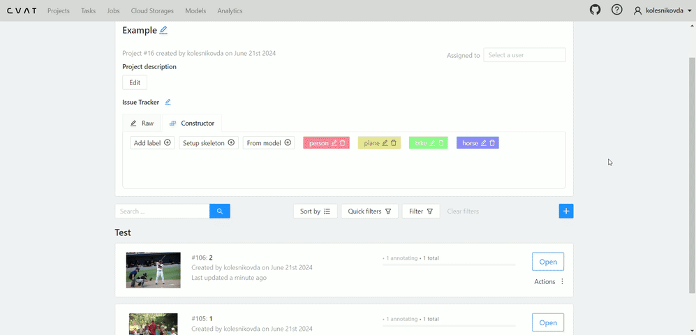
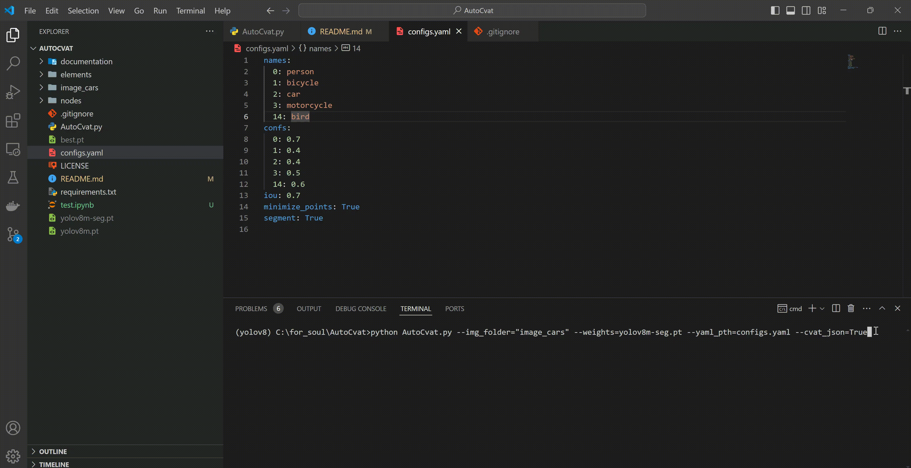

# __Auto-labling CVAT__

Creating __automatic annotation in CVAT__ using pre-trained [ultralytics models][1] or a semantic segmentation model. It supports both bounding box annotation for __object detection__ tasks and polygon annotation for __instance segmentation__ tasks.

Two backends are available:

- `yolo` — [ultralytics models][1] (YOLO, RT-DETR, FastSAM). Use it for object classes such as `car`, `person`, `truck`.
- `semantic` — SegFormer-B2 fine-tuned on Cityscapes (1024x1024). Use it for street-scene classes such as `road`, `sidewalk`, `building`, `vegetation`, `sky`.
- `panoptic` — runs both backends and merges them into one COCO file: stuff regions from SegFormer, things from YOLO, with stuff cut around detected things.

You need to provide the path to the folder with images that will be uploaded to the task in CVAT. As a result of the program's operation, a zip archive with annotations obtained based on the neural network inference will be formed.

All that remains to be done: after creating the task, go to the Actions panel and select `Upload annotations`. Then, choose `COCO 1.0` in the `Import format` section and upload the archive.



## Installation:
You need to have Python 3.8 or newer installed.
Run the following commands sequentially in your terminal:

1. Clone this repository to your local machine.
2. Navigate to the created folder using the command cd.

Install all necessary libraries:

```pip install -r requirements.txt```

__This repository supports all relevant models from Ultralytics:__ YOLOv8/v9/v10/11/12 (and lower) for detection and segmentation, RT-DETR, FastSAM, and YOLO-World (Real-Time Open-Vocabulary Object Detection).

## How to run the code:
To interact with the repository, you need to set the following command in the cmd terminal:
```
python AutoCvat.py --img_folder="images" --weights=yolo11m-seg.pt --yaml_pth=config.yaml
```
An example of a more fine-tuning with all possible CLI parameters:
```
python AutoCvat.py --img_folder=images --weights=yolo11m-seg.pt --annotations_zip=cars_annotations --yaml_pth=config.yaml --all_conf=0.2 --cvat_json=True --save_images_to_annotations_zip=True --zero_shot_segmentation=False
```

Table 1. Explanation of CLI command values:

| № | Command               | Description                                                                                   | Default value|
|---|-----------------------|-----------------------------------------------------------------------------------------------|--------------|
| 1 | img_folder  | Path to the folder containing images of CVAT task                                               |  -           |
| 2 | weights     | Path to the ultralytics model weights file (ex: yolov8m-seg.pt, yolov9c.pt, FastSAM-x.pt). Used by the `yolo` backend only |  -           |
| 3 | yaml_pth       | The path to configuration yaml file                                                          | config.yaml |
| 4 | annotations_zip       | Name of the COCO CVAT annotation zip archive produced by the program                  | annotations  |
| 5 | save_images_to_annotations_zip      | Whether to add images files to .zip annotations to upload to CVAT                                     | False        |
| 6 | cvat_json     | Should a json file with labels for CVAT be created                                            | False        |
| 7 | all_conf    | The value of the confidence of all model classes, condidences from config file don`t use        | None         |
| 8 | zero_shot_segmentation    | When set to True, it allows for zero-shot instance segmentation using SAM from any source detection network  | False |

For Russian users, there is a detailed video presentation of this project. YouTube video in Russian is available at this [link](https://www.youtube.com/watch?v=pyRvMj6JY_8).

## Configuration file

The project includes a configuration file that allows you to customize various parameters for your model, whether it's a custom or pretrained version. Here's a clearer breakdown of the settings available in this configuration file:

- Backend (backend): `yolo` for ultralytics detection/instance segmentation, `semantic` for Cityscapes semantic segmentation, or `panoptic` to run both and merge the results (uses `semantic:` and `instance:` sections).

- CVAT Labels (names): CVAT label id -> CVAT label name. These are the labels of your CVAT project, **not** model class indices.

- Class Mapping (mapping): Model class name -> CVAT label name. Mapping is done by **class name**, so it stays correct regardless of the weights file. Only mapped model classes are predicted and exported. Several model classes can map to the same CVAT label (e.g. `car`, `bus` and `truck` -> `vehicle`). If `mapping` is omitted, the old behaviour is used: the keys of `names` are treated as model class indices.

- Confidence Scores (confs): Per-CVAT-label confidence thresholds. Higher thresholds result in fewer potential objects being detected for each label, enhancing precision. With the semantic backend it is the per-pixel probability threshold.

- Intersection over Union (iou): This parameter is used for Non-Maximum Suppression (NMS), helping to decide which bounding boxes to keep by setting a threshold for overlap between boxes.

- Image Size (imgsz): This parameter determines the size to which input images are resized during model inference, affecting the resolution and processing speed.

- Minimize Points (minimize_points): When set to True, this parameter reduces the number of points in the polygons of the final markup, which is recommended for efficiency and simplicity.

- Segment Parameter (segment): This parameter specifies the type of task you want to perform:
  - True: For instance segmentation, where the model identifies and outlines each instance of a class. Creates polygonal markup in CVAT.

   - False: For object detection, where the model identifies the presence of objects without delineating their exact boundaries.Creates bounding box markup in CVAT.

This configuration file provides a flexible way to tailor the model's behavior to your specific needs, ensuring that the model's output aligns with your project requirements.

Below is an example of a YAML configuration file for the YOLO backend:

```
backend: yolo

names:
  0: person
  1: bicycle
  2: car
  3: motorcycle
  4: bird

mapping:
  person: person
  bicycle: bicycle
  car: car
  motorcycle: motorcycle
  bird: bird

confs:
  person: 0.7
  bicycle: 0.4
  car: 0.4
  motorcycle: 0.5
  bird: 0.6

iou: 0.7
imgsz: 640
minimize_points: False
segment: False
```

`names` keys are CVAT label ids (they must be unique), and `mapping` keys are the class names printed by the model. The keys of `confs` are CVAT label names. Every CVAT label used in `mapping` must exist in `names`; labels not used in `mapping` are allowed but produce no annotations.

If the "segment" parameter is set to True, but your model only supports detection, the output you will receive will be annotations from the detector. However, you can enable the --zero_shot_segmentation=True mode, which will allow the detection model to produce segmentation masks by using the detected bounding boxes as input prompts for a pre-trained neural network called SAM. The detailed explanation of this approach is provided in the "How to do Zero-shot instance segmentation for automatic annotation" section of the README.

**If you solve the detection issue, you do not need to use "minimize_points" parameter. It only applies to the segmentation task**

## Classes combining
You can combine several model classes into one CVAT label by mapping them to the same label name:

```
backend: yolo
names:
  0: person
  1: vehicle
  2: bird
mapping:
  person: person
  car: vehicle
  bus: vehicle
  truck: vehicle
  bird: bird
confs:
  person: 0.7
  vehicle: 0.4
  bird: 0.3
iou: 0.7
imgsz: 640
minimize_points: True
segment: True
```
At the exit you will get:


If you need to get the annotations of specific classes from YOLO, then you can see their names:
[COCO classes supported by YOLO models][2] 

## Utilize Zero-shot object detectors for automatic annotation (YOLO-World)

To speed up your pipeline cycle of annotation, training and model improvement a good solution is to use the [YOLO-World model][3]. This model allows you to detect any object in the image based on descriptive texts.

To get started you need to install the clip library:

```pip install git+https://github.com/openai/CLIP.git```

After that, set the classes that you want to detect and save your custom model:
```python
from ultralytics import YOLO

# Initialize a YOLO-World model
model = YOLO("yolov8x-world.pt")  # or select yolov8m/s-world.pt

# Define custom classes
model.set_classes(["dinosaur", "piano"])

# Save the model with the defined offline vocabulary
model.save("custom_yolo-world.pt")
```
Then you can use AutoCvat to get the annotations using custom weights:


## How to do Zero-shot instance segmentation for automatic annotation
It is possible to transform any initial detection neural network into an instance segmentation network. The output detection boxes are fed as input prompts into the SAM (Segment Anything Model), which allows for the generation of hypothetical polygon contours of objects. As an example, this approach can be used in conjunction with the Zero-shot detector YOLO-World, enabling Zero-shot instance segmentation (similar to the Grounded SAM approach).

To activate this mode, you need to add `--zero_shot_segmentation=True` to the terminal command and specify `segment: True` in the YAML configuration file.

Example of using the instance segmenter network obtained from YOLO-world:

```
python AutoCvat.py --img_folder="images" --weights=custom_yolo-world.pt --yaml_pth=config.yaml --zero_shot_segmentation=True
```


## Street-scene labels (road, sidewalk, building, vegetation, sky)

COCO-pretrained YOLO models cannot produce these labels: they are not COCO classes and they are "stuff" regions rather than isolated objects. Use the semantic backend instead. It runs SegFormer-B2 fine-tuned on Cityscapes, whose label set contains these classes, and converts every connected region into a CVAT polygon:

```yaml
backend: semantic
names:
  0: road
  1: sidewalk
  2: building
  3: vegetation
  4: sky
mapping:
  road: road
  sidewalk: sidewalk
  building: building
  vegetation: vegetation
  sky: sky
confs:
  road: 0.5
  sidewalk: 0.5
  building: 0.5
  vegetation: 0.5
  sky: 0.5
min_area: 300
minimize_points: true
semantic_model: nvidia/segformer-b2-finetuned-cityscapes-1024-1024
```

```
python AutoCvat.py --img_folder=images --annotations_zip=annotations --yaml_pth=config.yaml
```

The first run downloads the SegFormer weights from Hugging Face. The default is `nvidia/segformer-b2-finetuned-cityscapes-1024-1024`; for better quality (slower) switch to `nvidia/segformer-b5-finetuned-cityscapes-1024-1024`. Cars and other non-mapped objects are intentionally not annotated by this backend — if you need them too, run the YOLO backend separately and merge the two COCO JSON files, or train a custom YOLO11-seg model on your CVAT dataset and put its class names into `mapping`.

## Running the `easy_semantic` / `medium_instance` / `hard_panoptic` splits

The repository ships one config per task type. Put the images of each split in its own folder and point `--img_folder` at it:

| Split | Config | Backend | Annotation type |
|-------|--------|---------|-----------------|
| `easy_semantic` | `config_easy_semantic.yaml` | `semantic` | polygons for stuff labels only |
| `medium_instance` | `config_medium_instance.yaml` | `yolo` | polygons for each object instance |
| `hard_panoptic` | `config_hard_panoptic.yaml` | `panoptic` | stuff + things in one file, non-overlapping |

```bash
python AutoCvat.py --img_folder=easy_semantic --yaml_pth=config_easy_semantic.yaml --annotations_zip=easy_semantic_annotations
python AutoCvat.py --img_folder=medium_instance --weights=yolo11m-seg.pt --yaml_pth=config_medium_instance.yaml --annotations_zip=medium_instance_annotations
python AutoCvat.py --img_folder=hard_panoptic --yaml_pth=config_hard_panoptic.yaml --annotations_zip=hard_panoptic_annotations
```

`--img_folder` must contain the images directly (the tool does not scan sub-folders), so use e.g. `--img_folder=easy_semantic/images` if the images are inside an `images` sub-folder.

For `hard_panoptic`, `semantic:` and `instance:` are independent sections with their own `model`, `mapping`, `confs` and thresholds. `names` must list every label of the CVAT project, and every mapping target must exist in `names`. If your CVAT label names differ, edit `names` and the right-hand side of `mapping`; the left-hand side must keep the model class name (`car`, `person` for YOLO; `vegetation`, `road` for Cityscapes). In panoptic mode stuff regions are cut around the detected instances, so the same pixel is not labelled twice.

## How to create lables for your CVAT project
If you will set cli command `--cvat_json=True`, you will get json file containing everything you need to create a project for your auto annotations.
The contents of the json file must be inserted in "Raw" in the header of the project you created in CVAT:




[1]: https://docs.ultralytics.com/models/
[2]: https://github.com/ultralytics/ultralytics/blob/main/ultralytics/cfg/datasets/coco.yaml
[3]: https://docs.ultralytics.com/models/yolo-world/
